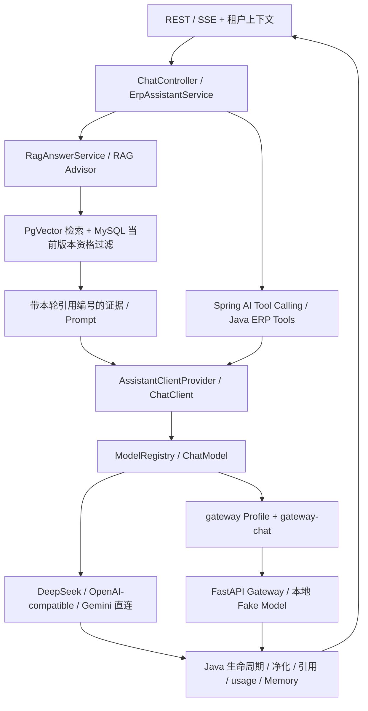

# P2 面试与复现指南

本项目基于 [ly1836/spring-ai-rag-demo](https://github.com/ly1836/spring-ai-rag-demo) 二次开发，保留原有 LICENSE。本指南描述当前源码和可核验的增量，不将整个企业 RAG/Agent 平台表述为个人从零原创。

## 1. 为什么保留 Java + Spring AI 主线？

这是以企业知识库和 ERP 数据查询为场景的 Java 后端项目。Spring Boot 管理 HTTP、租户、事务和持久化；Spring AI 统一 ChatClient、模型适配、RAG Advisor、Memory 和 Tool Calling。Python 是可选的模型协议边界，不持有业务状态，也不执行 ERP Tool。这里没有 LangChain/LangGraph，也不是自主规划、多 Agent 协作平台。

当前版本：Java 17、Spring Boot 4.0.7、Spring AI 2.0.0。版本依据 `pom.xml`；正式回归使用 Microsoft OpenJDK 17.0.16。

## 2. 一次问答经过什么？



`knowledge` 使用知识专用提示词和无 ERP Tool 客户端；`data` 使用业务工具；`auto` 组合原有 RAG 和工具能力。图中的工具执行是模型调用过程中的 Java 往返，不是 Python 调用数据库。

`ModelRegistry` 将前端 modelId 映射为 provider Bean；`AssistantClientProvider.resolveModelName` 决定上游 model 字段。请求通过 ChatOptions 覆盖模型名称，同 provider 可共享客户端。默认 Builder 固定使用 DeepSeek；空 modelId 选择默认，未知非空 ID 报错。Gateway 必须同时启用 Profile 和显式选择 `gateway-chat`。

已有 ID：`deepseek-chat`、`deepseek-reasoner`、`qwen-max`、`qwen-turbo`、`gemini-2.0-flash`。`qwen-max` 的配置别名实际映射 `qvq-max-2025-03-25`，不能仅凭 UI 名称宣称实际调用了其他模型。模型列表和连接配置在启动时绑定；请求可切换已装配的模型，不是运行时配置热更新。

## 3. 为什么用本地 ONNX Embedding？

文档导入和查询向量化使用同一个本地 embedding 身份，不依赖收费 embedding 服务。当前配置注明 `paraphrase-multilingual-MiniLM-L12-v2`，384 维、最大 128 token、均值池化；固定资源 SHA-256、tokenizer/ONNX 加载和中文排序断言见 [EmbeddingModelResourceTest](src/test/java/com/example/rag/chat/rag/EmbeddingModelResourceTest.java)。当前开发分支没有独立的 MODEL.md，模型固定修订及再分发许可清单仍需补齐，不能借其他快照的调查宣称这里已有完整文档。本地不等于无需准备资源：两个文件由 Git LFS 管理，新环境须获取实体；Windows DJL tokenizer 还需要原生 DLL 正确展开。

Tika 负责解析；TokenTextSplitter 后再次用真实 tokenizer 检查并切分，避免只按字符数猜 token。导入先做处理状态和新版本，再写向量；新版本失败时做精确补偿，旧 ready 版本继续有效。原项目已具备这些基础能力，本轮没有更换 embedding 或改变向量维度。

## 4. PgVector、租户和版本如何约束检索？

`RagAdvisorFactory` 先验证知识库可访问且启用，向量过滤包含租户、知识库和 embedding 身份；候选最多 24 条。`RagDocumentEligibilityFilter` 再依据 MySQL 元数据筛掉非当前 ready 版本、错误租户/知识库和不完整元数据，最后按文档分散选片段。向量里的旧数据不因相似度高就自动取得回答资格。

`knowledge` 当前参数为 topK=8、阈值 0.25；`auto` 为 5、0.5。历史评测的 Recall@5 是它自己的统计口径，不等同于生产 knowledge 只取 5 条。当前没有独立神经 reranker、BM25 混合检索或相邻 chunk 自动补全。

租户 Header 是上下文传递机制，不是完整认证。部署时需要可信身份层，不能把客户端可伪造的 Header 当成生产鉴权保证。

## 5. Tool Calling 是怎么完成的？

`AssistantClientProvider` 按 `ToolSnapshot.version` 装配代码 Tool 和动态 Tool；模型返回 tool_calls，Spring AI ToolCallingManager 在 Java 执行回调，将 tool_call_id 与结果送回模型，再得到最终回答。`ToolCallRecorder` 和结构化结果捕获用于本轮 trace 和图表绑定。Memory 用于理解上下文，业务数字要求本轮重新查询，不使用历史回答代替当前 Tool 结果。

动态 SQL 有只读校验和数据源边界；本轮没有放宽规则。39 个 ERP Tool、动态 SQL 及原有图表体系来自开源基础，不能将其数量写成个人新增。通过本地工具协议测试，也不能声称已联调真实 ERP 数据库或验证每个工具的业务准确性。

## 6. Gateway 解决什么？可以去掉吗？

Java **已经可以直连**模型。`spring.ai.openai.base-url` 配置完整 API 前缀，例如本地桩 `http://127.0.0.1:端口/v1`。Spring AI 2.0.0 不会替自定义地址补 `/v1`；adapter 再请求 `/chat/completions`。本轮用真实自动配置和本地 HTTP 验证了路径、model/messages、同步/流式、usage、同步/流式工具往返和 429；没有用真实供应商验收。

Python 的价值是可独立测试的 HTTP 校验、固定 alias 路由、白名单、body/frame 大小限制、connect/read/write/pool timeout、总 deadline、无重试、request_id、安全日志和 SSE 完整性检查。Python 不复制 RAG/Agent/计费/会话逻辑。

当前 Gateway 仅允许本地 Fake Model 上游，不能宣称已接入任意真实供应商。直连少一个进程和网络边界；Gateway 多一道可审计的协议和资源管理边界。普通 Java 运行及默认测试不需要 Python。保留 Gateway 作为可选增强；不为它迁移主业务，也不为直连再做一套 RAG。

重要差异：直接使用当前 OpenAI adapter 时，流提前 EOF 可能被当作完成，finish reason 为 `_UNKNOWN`；Gateway 要同时看到 finish_reason 和 `[DONE]` 才成功，否则发 OpenAI-compatible error data 帧。流已开始后无法改 HTTP status。不能把直连与 Gateway 的失败语义宣称为完全等价。

## 7. 如何解释误拒答、幻觉与引用？

历史固定集 50 条：45 条可回答、5 条无答案。第三轮 Recall@5=94.44%、MRR@5=87.59%、关键事实短语命中率=53.06%、无答案拒答=5/5；但可回答问题有 16/45 被判拒答。见 [RAG 评测总结](docs/rag-evaluation-summary.md) 和 [诊断复盘](docs/rag-optimization-review.md)。这是历史真实运行结果，不是本轮效果。

文档级召回不代表关键句被选中。历史复盘中能定位到切片跨边界、同文档其他片段代替答案片段、相似度阈值挡住低分关键句等情况。另一些样本可能受提示词影响，但缺少当时完整生成输入，不能将 16 条全部归因为 Prompt。

本轮只澄清“隐藏运行参数保护”和“上传技术文档的公开字段解释”的区别；保留证据不足固定拒答、禁止编造和本轮引用白名单。不降低阈值、不删除困难样本、不强制回答。提示词契约测试只能证明规则送到了模型，不能证明真实模型误拒答率下降；需要授权后用同集、同模型、同参数做付费 A/B 才能判断。

`RagContextFormatter` 给本轮证据稳定编号，`RagEvidenceExtractor` 取实际生成响应中的检索上下文，`RagCitationValidator` 只接受本轮来源并限制数量/大小；不做第二次检索伪造来源。结构有效的引用不等于结论被来源语义支持；当前没有可靠的逐句蕴含验证。流已展示的文本也不能由最终结构化引用校验追回。

## 8. SSE 出错或断开时怎么办？

Java `AssistantLifecycleService` 收集增量、usage、检索证据，集中完成净化、持久化和成功终态。异常/取消走独立终结路径，避免补发成功 done 或重复结算。已发送 delta 无法撤回。

Python 自己管理上游 response 和 httpx 连接，在错误、EOF、deadline、真正的下游 disconnect 时关闭；不简单返回 upstream response。Java adapter 是否立即传播前端取消尚有限制，跨语言测试验证的是网关 deadline 内释放，不能声称端到端瞬时取消。usage 上游缺失时网关保持缺失，不估算；Java 原有业务层可能使用 0 表示缺失，不能把 0 当成供应商计量证明。

## 9. 如何运行与复现？

### 不调用收费模型的验证

在项目根目录，安装依赖需提前完成；离线命令不下载依赖。Microsoft JDK 路径请按本机调整，独立 DJL 缓存只作用于当前终端：

```powershell
$env:JAVA_HOME=Join-Path $env:USERPROFILE '.jdks/ms-17.0.16'
$env:Path="$env:JAVA_HOME/bin;$env:Path"
$env:ENGINE_CACHE_DIR=Join-Path (Get-Location) 'target/interview-native-cache'
$env:DJL_OFFLINE='true'
mvn -version
mvn -o '-Dtest=OpenAiDirectHttpTest' test
mvn -o verify
```

直连测试使用 JDK 随机 loopback 端口的 HTTP 桩，只有 Java 进程，不要求 Python、数据库或 API Key。它不同于 Gateway Fake Model；现有 Fake Model 要求 Gateway proof，不能直接拿它做真实供应商直连证明。

Python 3.12 虚拟环境按 [网关说明](docs/model-gateway.md) 和 `requirements.lock` 准备，不随意升级依赖：

```powershell
model-gateway/.venv/Scripts/python.exe -m pytest model-gateway/tests -c model-gateway/pyproject.toml -q
powershell -NoProfile -File scripts/test-model-gateway.ps1
```

跨语言脚本实际启动 Spring Boot 测试探针 :8080、Gateway :8001、Fake Model :8002；检查端口空闲并只清理自己创建的进程。它复用真实客户端/adapter，不启动完整业务应用及数据库。不要把这个隔离探针验收写成真实知识库/ERP 全业务端到端验收。

### 完整应用：Java 直连

准备受控 MySQL/PgVector 和模型实体；真实启动会初始化演示数据。不要直接运行在生产数据库上。通过本地环境提供 `SPRING_DATASOURCE_PGVECTOR_URL/USERNAME/PASSWORD`、`SPRING_DATASOURCE_ERP_URL/USERNAME/PASSWORD`，以及需要的模型接入配置。凭据不写进源码或文档；本轮未读取或使用它们。

`mvn spring-boot:run` 默认 DeepSeek 直连，无 Python 依赖。选择已有 OpenAI-compatible 路由时，设置 `SPRING_AI_OPENAI_BASE_URL` 为含 API 版本的完整前缀、`DASHSCOPE_API_KEY` 为授权凭据，并显式选择 `qwen-turbo` 等已配置 modelId。ID 与实际 model-name 的对应关系见 `application.yml`，不是任意上游模型名都能直接作为 modelId。

OpenAI SDK 连接参数用 `SPRING_AI_OPENAI_TIMEOUT`、`SPRING_AI_OPENAI_MAX_RETRIES`；本地直连测试显式用 2s、0 重试。不要把通用 `spring.ai.retry.*` 当成已控制所有 SDK 重试的证明。未新增强制直连 Profile，也未把未经供应商实测的接入改成新的默认。

### 完整应用：可选 Gateway

按网关文档启动两个本地 Python 进程；Java 用 `mvn spring-boot:run '-Dspring-boot.run.profiles=gateway'`，请求显式选 `gateway-chat`。省略 ID 仍为 DeepSeek；本地演示时不要误发无 modelId 请求。完整应用仍需数据库；隔离演示优先使用上述跨语言脚本。

现有 Docker Compose 只有应用、PgVector、MySQL，没有强制 Python 服务。默认应用镜像是上游镜像；演示本地改造必须先构建当前源码镜像。Docker、本轮真实数据库与真实模型接入均未验收。

## 10. 贡献边界与真实限制

| 范围 | 可以表述 | 不可表述 |
|---|---|---|
| 上游已有 | 基于现有 Java RAG/ERP/租户/版本/引用/持久化平台二次开发 | 从零独立实现整个平台、独立开发全部 39 个 ERP Tool |
| 既有个人增量（81bad69、2f44292） | 回答净化与协议稳定性、固定集评测诊断及局限记录 | 独立发明 RAG 算法、保证所有答案可信 |
| Gateway 增量（0b6a54b） | 严格显式路由、FastAPI/httpx 网关、协议与跨语言测试 | 实现 Spring AI 或 OpenAI SDK、生产模型调度平台 |
| 本轮 | 修正直连 API 前缀、增加本地直连协议回归、澄清知识提示词边界与复现文档 | 已降低真实模型误拒答、已完成供应商/生产性能验收 |

其他限制：无生产 SLA、吞吐/成本改进数据，无分布式限流/供应商容灾；Header 不是认证；缺少 rerank/完整证据快照；模型资源与 DJL 原生缓存需准备；扩展缺失 provider 的 Bean 时部分历史路径仍可能使用默认 Builder，当前只对未知 ID 和缺失 Gateway 强制失败。不要把保留的扩展映射当成所有供应商均已验收。

原开发仓库还保留上游旧历史及本地开发配置风险，当前源码工作不代表已完成重新发布安全审计；不应直接推送旧历史。本轮没有读取 `.env`、处理 `test-data/` 或进行 Git 发布。

## 11. 可核验的简历表述

1. 在开源 Spring AI 企业 RAG/ERP 项目基础上，改进知识问答输出协议与回答净化，建立固定 50 条评测及拒答诊断；记录召回、事实命中与过度拒答的不同边界，不以高召回替代答案质量。
2. 增加独立模型 ID 和 Profile 路由，基于 FastAPI/httpx 实现可选 OpenAI-compatible 网关，包含请求校验、固定上游白名单、超时/deadline、错误分类和脱敏日志。
3. 实现并验证 SSE 完整性检测、Tool Calling 和 usage 透传，以本地三进程集成测试验证 Java → Python → Fake Model 及工具结果回传，不将 Mock 计量冒充真实 Token 成本。
4. 核实 Spring AI 2.0.0 直连适配行为，修正兼容模型 API 前缀，并用 7 项本地 HTTP 回归覆盖同步/流式、Java 工具往返、usage 和 429；复用同一 RAG/Agent 业务链，无跨语言强制依赖。

本轮实际测试、证据路径和未验证项见 [架构审查与验证记录](docs/p2-architecture-review.md)。面试时展示源码、测试命令和逐例问题，避免将测试数替代业务能力。

最短启动、两条业务调用链、协议演示与真实业务演示的边界见 [简洁演示说明](docs/p2-demo.md)。2026-10-21 收尾未执行真实模型调用；三个代表性失败案例、下一轮唯一优先待办及待确认提交清单见架构审查记录末节。
