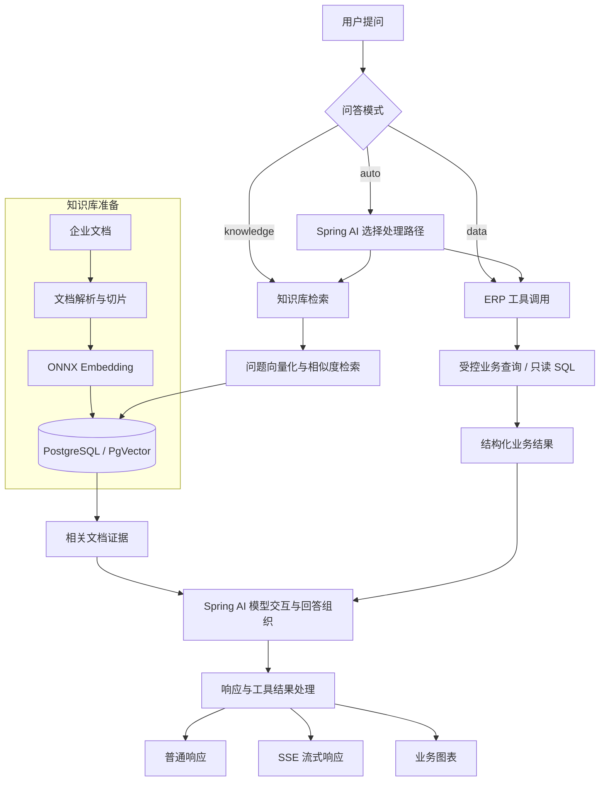

# Enterprise RAG & ERP Assistant

**企业级 RAG 与 ERP 智能业务助手**

基于 Java 17、Spring Boot 与 Spring AI 构建的企业知识检索和 ERP 业务问答应用。系统结合检索增强生成（RAG）、结构化业务查询、模型工具调用与 SSE 流式响应，为企业文档问答和业务数据查询提供统一入口。

本项目基于 [ly1836/spring-ai-rag-demo](https://github.com/ly1836/spring-ai-rag-demo) 二次开发，在已有应用基础上重点改进了 SSE 流式响应处理、模型与工具调用测试，以及问答质量诊断和检索评测。项目的上游来源及修改范围见仓库相关文档。

## 项目简介

企业业务问答主要涉及两类数据：制度文档、产品资料等非结构化知识，以及 ERP 系统中的订单、库存等结构化业务数据。前者适合通过 RAG 检索相关证据，后者需要通过受控业务工具获取实际数据。

项目使用 Spring AI 组织模型交互，支持按问题类型选择知识检索或 ERP 工具调用，并通过普通响应或 SSE 流式响应返回问答结果。

## 核心功能

### 1. 企业文档检索与问答

- 支持文档解析、文本切分、Embedding 向量化和相似度检索。
- 使用本地 ONNX Embedding 模型生成向量，通过 PostgreSQL / PgVector 检索相关文档片段。
- 结合知识库、用户和文档版本等上下文筛选检索结果。
- 根据检索证据组织回答与引用信息。

### 2. ERP 结构化数据查询

- 通过 Spring AI 工具调用访问 ERP 业务数据。
- 支持多类业务工具、动态工具调用及受控的只读 SQL 查询。
- 将工具执行结果交给模型整理，用自然语言回答结构化业务问题。
- 支持结合业务结果生成图表。

### 3. 统一对话与流式响应

系统提供三种问题处理模式：

| 模式 | 主要用途 |
|---|---|
| `knowledge` | 企业文档与知识库问答 |
| `data` | ERP 结构化业务数据查询 |
| `auto` | 根据问题选择知识检索或业务工具 |

同时支持会话管理、普通回答、SSE 流式响应及工具执行结果处理。

### 4. 可选 Python 模型网关

项目提供基于 Python、FastAPI 的可选模型网关，用于集中处理 OpenAI-compatible 模型请求，包括请求转发、超时控制、错误映射和流式响应完整性检查。网关可与 Java 主应用配合部署。

## 二次开发与关键改进

在原有 Spring AI 应用基础上，围绕流式输出稳定性、工具调用链路测试和 RAG 效果评估开展以下改造。

### 1. SSE 流式响应处理

针对模型内部标记重复输出和 ERP 业务字段误删问题，改造跨数据块缓存与增量处理逻辑。

- 缓存跨 SSE 数据块出现的不完整标记，按增量内容进行处理。
- 过滤模型内部标记及工具执行提示，减少无关信息进入最终响应。
- 保留 ERP 业务字段，避免响应清理破坏正常的结构化业务结果。
- 补充流式输出测试，检查分块内容、结束事件及响应完整性。

### 2. 模型响应与工具调用测试

围绕同步与流式模型调用链路，补充协议及集成测试。

- 测试工具调用参数跨数据块拼接与工具执行结果回传。
- 检查 Token 用量信息、SSE 结束事件及模型响应结构。
- 覆盖工具调用、流式响应和模型接口异常等场景。

### 3. 问答质量诊断与检索评测

使用固定测试集和离线对照实验，定位问答问题并分析检索参数的影响。

- 记录原始回答、最终回答的 HMAC 值及检索元数据，便于对照分析。
- 基于 50 道固定测试题开展三轮问答质量评测。
- 设计 6 组离线检索对照实验，比较相似度阈值、Top-K 和相邻片段策略。
- 分析检索证据覆盖、无答案问题中的非空检索情况以及上下文长度变化。

## 技术架构与执行流程

系统将**文档准备**与**在线问答**分开：文档在入库阶段完成解析、切分和向量化；在线查询时使用问题向量检索已有文档片段，或通过业务工具访问 ERP 数据。



### 知识库问答链路

1. 文档解析、切片并通过 ONNX Embedding 编码，写入 PgVector。
2. 用户选择 `knowledge` 模式或在 `auto` 模式下进入知识检索流程。
3. 查询文本被向量化后检索相关文档片段，结合上下文条件筛选证据。
4. Spring AI 使用检索证据组织回答，并返回相应引用信息。

### ERP 业务查询链路

1. 用户选择 `data` 模式或在 `auto` 模式下进入工具调用流程。
2. Spring AI 调用相应业务工具，执行受控 ERP 查询或只读 SQL。
3. 将结构化查询结果交给对话流程整理，并按请求形式返回文字或图表。

### SSE 流式响应链路

流式处理对模型返回的数据块进行增量处理，通过跨块缓存识别标记边界，过滤内部提示并保留 ERP 业务字段，最终向客户端输出 SSE 事件。

可选 Python Gateway 可作为模型请求的协议适配层，负责请求转发、超时和错误响应处理。

## 技术栈

| 技术 | 用途 |
|---|---|
| Java 17、Spring Boot | 后端服务、业务接口与应用配置 |
| Spring AI | 模型调用、RAG 流程和工具调用 |
| PostgreSQL、PgVector | 业务数据与文档向量检索 |
| ONNX Runtime | 本地 Embedding 模型推理 |
| Python、FastAPI | 可选模型网关 |
| Docker Compose | 本地依赖与服务部署 |
| Maven、JUnit Jupiter | Java 项目构建与测试 |

具体依赖版本以 `pom.xml`、Python 依赖声明和部署配置为准。

## 测试与验证

### 1. 工程与协议测试

| 验证范围 | 测试结果 |
|---|---:|
| Maven `verify`（对应发布快照） | 417 项通过 |
| Python Gateway 合约测试（对应历史测试批次） | 51 项通过 |
| Python 离线诊断工具测试 | 16 项通过 |
| Python 依赖一致性检查 | 通过 |

各项验证属于不同测试范围及执行批次。详细结果见 [TEST_REPORT.md](TEST_REPORT.md) 和 [SAFE_SNAPSHOT_AUDIT.md](docs/SAFE_SNAPSHOT_AUDIT.md)。

### 2. RAG 问答质量评测

针对 50 道固定测试题进行三轮 knowledge RAG 问答评测，其中包含可回答题与无答案题。

| 指标 | 第一轮 | 第二轮 | 第三轮 |
|---|---:|---:|---:|
| 最终空回答数 | 25/50 | 22/50 | 0/50 |
| 关键事实短语字面命中率 | 36.73% | 39.80% | 53.06% |

三轮评测记录了回答质量变化，检索评测另使用 Recall@K、MRR@K 等指标分析来源检索情况。关键事实短语字面命中率衡量预设事实短语的文本命中情况。

### 3. 离线检索对照实验

围绕固定测试集开展 6 组检索参数对照，重点比较：

- 相似度阈值变化对检索结果及证据覆盖的影响。
- Top-K 设置对候选文档数量和上下文长度的影响。
- 相邻片段策略对检索上下文及无答案题非空检索情况的影响。

实验设置、逐轮指标和完整结果见 [TEST_REPORT.md](TEST_REPORT.md) 及 [RAG 质量比较](docs/p2-rag-quality-comparison.md)。

## 快速开始

### 环境要求

- JDK 17
- Maven
- Docker Desktop 与 Docker Compose（使用容器部署时）
- Git LFS（获取仓库中的模型资源）
- Python 环境（启用 Python Gateway 时）

### 1. 克隆仓库

```bash
git clone https://github.com/qianmu233/enterprise-rag-erp-assistant.git
cd enterprise-rag-erp-assistant
git lfs install
git lfs pull
```

### 2. 配置运行环境

根据 `docker-compose.yml`、`deploy/` 目录和应用配置文件，准备 PostgreSQL、模型服务及相关连接参数。

数据库凭据和模型 API Key 通过环境变量或本地配置提供，不提交到 Git 仓库。

### 3. 构建项目

```bash
mvn verify
```

### 4. 启动应用

按项目部署配置启动所需容器服务，或在准备好外部依赖后使用 Maven 启动 Java 主应用：

```bash
mvn spring-boot:run
```

启动端口、依赖服务及具体环境参数以仓库配置为准。使用 Docker Compose 启动完整应用时，无需同时在本机重复启动相同服务。

## 相关文档

- [测试与质量验证报告](TEST_REPORT.md)
- [RAG 质量比较与诊断](docs/p2-rag-quality-comparison.md)
- [发布快照审查](docs/SAFE_SNAPSHOT_AUDIT.md)

## 许可证与来源

本项目基于 [ly1836/spring-ai-rag-demo](https://github.com/ly1836/spring-ai-rag-demo) 进行二次开发。原有知识问答与 ERP 功能和后续的流式响应改造、测试及评测工作，按仓库的来源与修改说明区分。

项目采用 **Apache License 2.0**。许可条款、上游来源及第三方资源信息见 [LICENSE](LICENSE)、[NOTICE](NOTICE) 与仓库中的相关说明。

欢迎通过 Issues 交流问题与改进建议。
