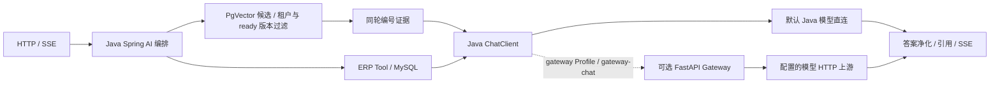

# Spring AI RAG Demo · ERP 知识与数据助手

基于 [ly1836/spring-ai-rag-demo](https://github.com/ly1836/spring-ai-rag-demo) 二次开发的 Java RAG / ERP Tool Calling 工程，补充模型网关、输出处理、协议验证与质量诊断。

本目录是 2026-10-26 新建的独立安全发布快照，文件基于已审核发布 main `3efdbd00840f5f168437c5a77244b97a98368555`，不继承原开发仓库或旧发布仓库的 Git 历史。所有旧业务样例行已排除，改用明确的公开合成 ERP seed；无旧手机号、原开发 `test-data/`、截图、GIF、聊天日志或缓存。见[快照边界](docs/publication-sync.md)、[合成数据说明](docs/SYNTHETIC_DATA.md)及[本次验收](docs/SAFE_SNAPSHOT_AUDIT.md)。

## 场景与功能

面向企业文档问答与制造业 ERP 数据查询：从上传文档检索证据，或通过受控业务工具查询数据，再以普通响应或 SSE 返回答案、引用和可选图表。

- `knowledge`：仅知识库 RAG；`data`：ERP Tool Calling；`auto`：同时装配检索与业务 Tool。
- 文档解析、Token 切片、本地 ONNX Embedding 与 PgVector 检索；按租户、知识库、模型身份及 ready 文档版本筛选证据。
- 文档替换成功后晋级新版本；导入失败保留上一可用版本，并补偿清理对应向量。
- 回答净化、同轮引用编号白名单、会话记忆与 SSE 生命周期处理。
- 代码 ERP Tool、动态只读 SQL Tool、调用追踪及基于当前轮工具结果的图表生成。
- 可选 Python FastAPI Gateway，集中验证 OpenAI-compatible 请求、超时、错误与流式完整性。

## 来源与工作边界

| 来源 | 范围 |
|---|---|
| 上游 `4.0.0` / `b0bd1fd` 已有 | Spring AI 主编排、Java 模型直连、核心 RAG、文档管理、租户上下文、SSE、会话/计费、8 类共 39 个 ERP `@Tool` 方法、动态 Tool 与图表基础 |
| 后续增强 | 答案净化边界与拒答统计、可选 Java/Python Gateway、Java 直连地址修正与协议回归、知识提示词边界澄清、脱敏执行诊断与离线重建实验 |

不将上游业务 Tool、框架能力或 AI 辅助代码全部归为个人从零原创；具体增量与验证见 [架构审查](docs/p2-architecture-review.md) 和 [发布同步说明](docs/publication-sync.md)。

## 技术栈

| 层 | 实现 |
|---|---|
| Java | Java 17、Spring Boot **4.0.7**、Spring AI **2.0.0**、MyBatis-Plus **3.5.16** |
| RAG | Tika、Token 切片、Java 本地 ONNX、PgVector 向量检索 |
| Embedding | `paraphrase-multilingual-MiniLM-L12-v2`，384 维、128 token 上限，固定模型/分词器身份 |
| 数据 / 界面 | MySQL、PostgreSQL + vector、Spring MVC / Reactor SSE、原生 JS / ECharts |
| 可选网关 | Python 3.12、FastAPI、httpx；不承担 RAG 或 ERP Tool 编排 |

版本依据：[pom.xml](pom.xml)、[网关依赖](model-gateway/pyproject.toml)、[模型身份](src/main/resources/models/embedding/MODEL.md)。Java 运行模型需要支持 AVX2 的 x86-64 CPU。

## 架构与调用链



Spring AI 是 RAG 与 Tool Calling 的主要编排框架。Python 不是默认必经组件，项目未使用 LangGraph 主导业务。MySQL 保存关系数据和文档版本资格，PgVector 保存分片正文、向量及身份元数据。

## 关键模块

| 入口 | 设计 |
|---|---|
| [文档导入](src/main/java/com/example/rag/knowledge/KnowledgeDocumentIngestionService.java) | 解析/切片与文档版本状态协作，失败保留可用旧版本 |
| [RAG 工厂](src/main/java/com/example/rag/chat/rag/RagAdvisorFactory.java) | 向量候选过采样；租户/知识库/模型过滤；资格校验与文档多样性选取 |
| [引用校验](src/main/java/com/example/rag/chat/rag/RagCitationValidator.java) | 仅引用本轮实际证据，不再检索一次补引用；合法编号不等于语义支持 |
| [助手服务](src/main/java/com/example/rag/chat/ErpAssistantService.java) | 知识客户端与 ERP 客户端分开，处理净化、引用、SSE、当轮工具数据和图表 |
| [模型注册](src/main/java/com/example/rag/chat/ModelRegistry.java) / [Gateway](model-gateway/) | Java 直连已存在；网关按显式路由启用，处理请求契约、deadline、错误和提前 EOF |

生产知识检索仍为 Vector Search，最终上限 8、阈值 0.25；没有 BM25 混合检索或语义 Rerank。**离线邻片/阈值实验未上线生产策略**。

## 配置与快速启动

准备 JDK 17、Maven、Git LFS、MySQL 和启用 `vector` 扩展的 PostgreSQL。在仓库根目录：

```bash
git lfs install --local
git lfs pull
git lfs fsck
java -version
mvn -version
mvn test
```

构建前必须取得完整模型资源；不能把 LFS 指针当权重打包。数据库与模型连接由环境变量提供：

| 用途 | 环境变量 |
|---|---|
| PgVector | `SPRING_DATASOURCE_PGVECTOR_URL`、`SPRING_DATASOURCE_PGVECTOR_USERNAME`、`SPRING_DATASOURCE_PGVECTOR_PASSWORD` |
| ERP/MySQL | `SPRING_DATASOURCE_ERP_URL`、`SPRING_DATASOURCE_ERP_USERNAME`、`SPRING_DATASOURCE_ERP_PASSWORD` |
| 模型 | `DEEPSEEK_API_KEY`、`DASHSCOPE_API_KEY`、`GOOGLE_GENAI_API_KEY`，按启用路由提供 |

配置就绪后运行 `mvn spring-boot:run`，访问 `http://localhost:8080`。启动会初始化 ERP 表及演示数据，导入文档会写入 PgVector，请使用独立演示数据库。Java 直连的 DashScope Base URL 已含 `/compatible-mode/v1`；Spring AI 此适配不会替配置自动补 `/v1`。

Compose 方式需另提供 `POSTGRES_PASSWORD`、`ERP_DB_PASSWORD`；先 `docker build -t ly753/spring-ai-rag-demo:latest .` 再 `docker compose up -d --pull never`，才能运行本地源码对应镜像。此处沿用 Compose 中的上游镜像标签作为本地构建标签，不推送该标签，也不把远程 `latest` 当作当前代码。本快照未启动 Compose；镜像或 JAR 对外分发的依赖许可须另行审查。网关安装与独立启动见 [Gateway 文档](docs/model-gateway.md)；完整操作见 [演示说明](docs/p2-demo.md)。

## API 示例

接口接受 `X-Ent-Code`，可选 `X-User-Id`，值需与自己的演示租户匹配：

```bash
curl -G 'http://localhost:8080/api/ask' \
  -H 'X-Ent-Code: <演示租户编码>' \
  --data-urlencode 'question=上传文档支持哪些格式？' \
  --data-urlencode 'mode=knowledge'
```

`GET /api/ask/stream` 提供 SSE；`GET /api/models` 列出已配置模型；文档和知识库入口见 [Controller](src/main/java/com/example/rag/controller/)。租户 Header 是上下文传递，**不是生产身份认证**。

## 测试与验证

以下为已执行并留档的验证结果，版本、统计口径和完整质量记录见 [测试报告](TEST_REPORT.md)。

| 范围 | 验证内容与结果 |
|---|---|
| Java 回归与构建 | 发布快照已通过 417 项测试，覆盖文档导入、资格过滤、引用、输出处理、Tool Calling 与模型 HTTP 契约 |
| Python 与跨语言协议 | 已记录网关 51 项测试、三进程集成 14 项测试及离线工具 16 项测试通过；各自范围独立，模型响应使用本地桩 |
| RAG 质量评估 | 已完成 50 条小规模真实评测，覆盖单文档、多文档、同义改写、无答案与隔离场景；复杂证据召回和跨片段问答仍有质量限制 |

`mvn test` 运行默认测试；已有缓存可用 `mvn -o test`。`rag-eval` Profile 会调用真实模型/Judge 并写入隔离评测数据，可能产生费用，不属于默认测试。文档召回、引用编号合法性与最终回答质量分别评估，不能用检索指标代替回答准确率。

## 已知限制

复杂问题可能出现关键证据漏召回、跨片段整合不足或过度拒答，尚未证明这些质量限制已经改善，详见 [测试与诊断记录](TEST_REPORT.md)。引用编号合法不证明答案事实正确，无证据拒答仍依赖模型提示。

SSE 已发正文不可撤回，协议冲突与空正文尚未全部统一为失败。租户入口需要可信认证网关；只读 SQL 校验不是任意 SQL 沙箱。各 Provider 适配存在不等于全部完成真实供应商验收；没有大型真实语料、并发负载或生产 SLA 结论。

## 许可与文档导航

保留上游 [Apache-2.0 LICENSE](LICENSE) 与 [NOTICE](NOTICE)。模型和前端资源来源见 [第三方资源说明](docs/third-party-resources.md)；两项模型使用全新根下的 Git LFS。英文摘要见 [README_EN.md](README_EN.md)，不迁入上游截图或旧英文历史展示。

[架构审查](docs/p2-architecture-review.md) · [质量诊断](docs/p2-rag-quality-diagnosis.md) · [诊断比较](docs/p2-rag-quality-comparison.md) · [演示](docs/p2-demo.md) · [发布同步](docs/publication-sync.md) · [公开配置边界](docs/publication-safety.md) · [README 修订依据](docs/readme-review.md)
